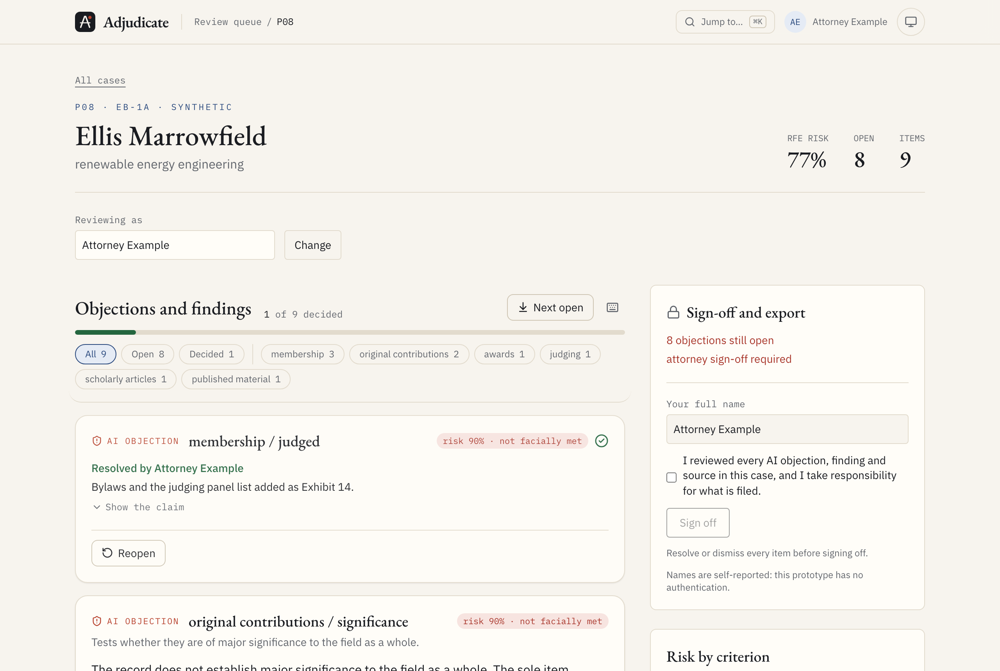
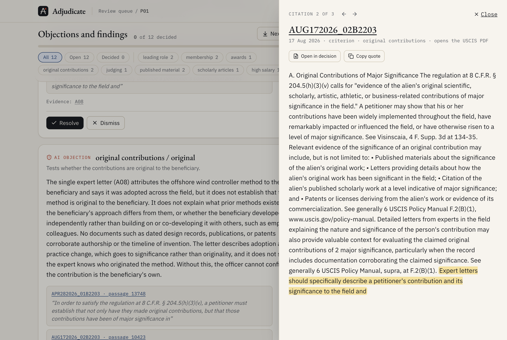
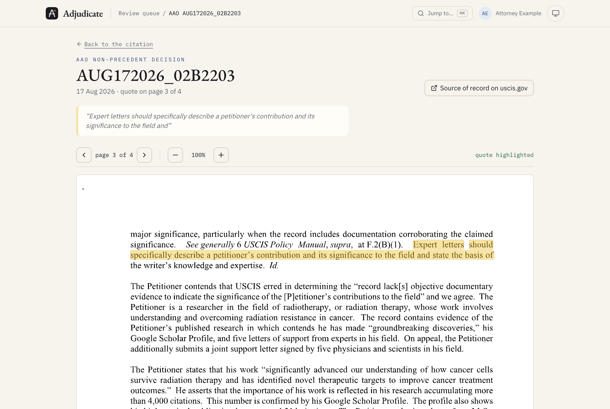

<div align="center">

# Adjudicate

**Meet the reader who wants to say no, before you file.**

An adversarial pre-filing reviewer for EB-1A extraordinary-ability petitions.<br>
Every objection is grounded in AAO decisions, and nothing leaves without an attorney's sign-off.

[**Live site**](https://amith71965.github.io/adjudicate/) &nbsp;·&nbsp;
[**Interactive diagrams**](https://amith71965.github.io/adjudicate/#diagrams) &nbsp;·&nbsp;
[**24-second tour**](https://amith71965.github.io/adjudicate/#tour) &nbsp;·&nbsp;
[**Results**](#-results)


[](https://github.com/Amith71965/adjudicate/actions/workflows/verify.yml)


[](LICENSE)

<br>

<picture>
  <source media="(prefers-color-scheme: dark)" srcset="docs/images/review-case-dark.png">
  
</picture>

<sub>A synthetic case under review: one objection resolved with a note, eight to go, and the export still locked.</sub>

</div>

<br>

> [!IMPORTANT]
> A portfolio prototype built in nine phases, each with a measured exit gate. Every petition and applicant in it is synthetic. It is not legal advice.

## ✦ What it does

An EB-1A petition must prove at least three of ten criteria, then survive a holistic "final merits" look (*Kazarian v. USCIS*). When a petition fails and is appealed, the AAO publishes its reasoning, and thousands of those decisions amount to a record of what officers actually object to.

Adjudicate turns that record into a reviewer that argues against your petition on purpose:

| It will not skip… | How |
|---|---|
| **An objection on every claimed criterion** | For each criterion, and each half of the two-part ones, it writes the request for evidence an officer would. |
| **Every claim shows its source** | Citations must point to retrieved AAO passages, with the quote verbatim. Hover for a preview; one click opens the passage, one more opens the decision PDF, the words highlighted. |
| **An attorney signs before anything leaves** | Each objection is resolved or dismissed with a note, in an append-only log. The server refuses to export until a sign-off postdates the last change. |

<div align="center">
<picture>
  <source media="(prefers-color-scheme: dark)" srcset="docs/images/review-passage-dark.png">
  
</picture>
<br><sub>One click from a citation: the full AAO passage, with the quoted words highlighted.</sub>
<br><br>
<picture>
  <source media="(prefers-color-scheme: dark)" srcset="docs/images/review-viewer-dark.png">
  
</picture>
<br><sub>One more: the decision itself, opened on the right page, with the sentence marked in the PDF.</sub>
</div>

### The four failure modes it looks for

| | Failure mode | Example |
|:-:|---|---|
| **A** | Evidence filed under the wrong criterion | A conference talk claimed as a "scholarly article" |
| **B** | Only half of a two-part criterion proven | A leading role, but nothing on the organization's reputation |
| **C** | Assertion without mechanism | "One of the most brilliant engineers of her generation", and nothing about what she changed |
| **D** | Waiver: not raised now, lost on appeal | Evidence for a criterion the petition never claims |

<details>
<summary><b>See the legal test and the failure modes as diagrams</b></summary>
<br>
<p align="center"></p>
<p align="center"></p>
</details>

## ✦ Results

I graded the examiner on **145 real AAO decisions it had never seen**: every EB-1A merits decision issued from June to September 2026. Each one was reduced to facts only, with verdict words removed, and retrieval was cut off before 1 June. All 5,864 cited passages were checked against the cutoff, with **zero leaks**.

<p align="center"></p>

| Criteria the AAO decided | F1 | Recall | Precision | AUROC | F1, fitted threshold¹ |
|---|:-:|:-:|:-:|:-:|:-:|
| **Adjudicate** | **0.80** | **0.99** | 0.67 | **0.66** | 0.79 |
| Always say "not met" | 0.78 | 1.00 | 0.65 | — | 0.79 |
| Copy the Director's finding² | 0.83 | 0.78 | 0.90 | — | 0.84 |

<sub>¹ Threshold fitted on June, scored only on July to September (94 decisions). &nbsp; ² An oracle: no pre-filing tool has the Director's finding. &nbsp; F1 95% CI for Adjudicate: 0.75–0.84.</sub>

> [!NOTE]
> **How to read this.** It is a strong objector: it misses 3 of the 348 criteria the AAO rejected. It is not yet a sharp judge. At a fitted threshold it ties a baseline that always says "not met", which is hard to beat because most appealed criteria really do fail. Judging is its weakest criterion (precision 0.25). That is why the baseline is printed beside the score, and why `make verify` fails if a later change drops it.

<details>
<summary><b>Every phase gate</b></summary>
<br>

| Phase | What was measured | Result |
|---|---|---|
| 1 · Harvest | Decisions fetched at the robots crawl-delay of 10 s | 729 (EB-1A 450, O-1 219, NIW 60), 0 duplicates |
| 2 · Parse | Field accuracy on 25 hand-labelled 2025 decisions | **94.2%**; the owner's blind re-label agrees on **68/68** fields |
| 3 · Retrieval | Recall@10 on 44 labelled queries | **0.89** hybrid (vector 0.84, lexical 0.66) |
| 4 · Mapper | Evidence to the right criterion, 20 synthetic petitions | 100% top-1, every planted mismatch caught |
| 5 · Examiner | Grounding on a held-out synthetic set | 344 citations, **0 fabricated**; planted flaws 40/40 |
| 6 · Letters | Assertion-without-mechanism, held-out letters | P 1.00 / R 1.00 (a keyword baseline: 0.62 / 0.47) |
| 6 · Merits | Kazarian step two, strong/weak pairs | 6/6 weak caught, 6/6 pairs ordered |
| 7 · Real eval | 145 held-out AAO decisions | see above |
| 8 · Review UI | The attorney's flow in a real browser | passes; export is blocked until sign-off |

The whole project ran on about **$4** of model calls. Every call is cached and capped, and embeddings run locally.
</details>

<details>
<summary><b>What the numbers do not tell you</b></summary>
<br>

- **Survivorship bias.** AAO decisions exist only for petitions that were denied and appealed, so "not met" is usually the right answer.
- **The synthetic gates are easy.** Phases 4 to 6 ran on generated petitions with planted flaws. The same developer wrote the generator and the system, so those scores prove the machinery, not generalization.
- **Labels are not an attorney's.** They were checked against a hand-labelled gold set and a blind re-label, not by immigration counsel.
- **The text is OCR.** Redacted PDFs come with defects such as `EB-I`, `ofthe` and `8 C.F .R.`. The common ones are repaired, not all of them.
- **O-1 is thin.** O-1 decisions are harvested and parsed, but they are not split into O-1A (sciences, business) and O-1B (arts). That sub-classifier was planned and not built, so the examiner and the evaluation cover EB-1A only.
- **It is a prototype.** It has no authentication, and reviewer names are self-reported.
</details>

## ✦ Architecture

<p align="center"></p>

- **Python owns the data:** harvesting, OCR repair, per-criterion verdicts, local embeddings, hybrid search (pgvector plus Postgres full-text, fused with RRF), FastAPI, and the evaluation.
- **TypeScript owns the agent and UI:** the examiner on the Vercel AI SDK, an MCP server that exposes the corpus as tools, and the review UI on Server Actions.
- **One schema:** Pydantic is the source of truth, Zod is generated from it, and `make verify` fails if they drift.
- **Loud failures:** a down database is a 503, never an empty result. "Corpus unavailable" must never look like "no precedent found".

> [!TIP]
> Every diagram has an **interactive version** on the [live site](https://amith71965.github.io/adjudicate/#diagrams), with pan, zoom, light and dark modes, and relationship tracing.

| To understand… | Open |
|---|---|
| The system as built, or as first planned | [as built](https://amith71965.github.io/adjudicate/interactive/architecture-as-built.html) · [as planned](https://amith71965.github.io/adjudicate/interactive/architecture-plan.html) |
| How decisions are collected from USCIS | [Harvest dataflow](https://amith71965.github.io/adjudicate/interactive/harvest-dataflow.html) |
| How a PDF becomes structured verdicts | [Parse workflow](https://amith71965.github.io/adjudicate/interactive/parse-workflow.html) · [corpus pipeline](docs/blog/blog-03-corpus-pipeline.svg) |
| How the database is laid out | [Corpus ERD](https://amith71965.github.io/adjudicate/interactive/corpus-erd.html) |
| What happens on a search | [Retrieval sequence](https://amith71965.github.io/adjudicate/interactive/retrieval-sequence.html) |
| How the examiner checks its own citations | [Examiner sequence](https://amith71965.github.io/adjudicate/interactive/examiner-sequence.html) |
| How letters and final merits are reviewed | [Letters and merits](https://amith71965.github.io/adjudicate/interactive/letters-merits-workflow.html) |
| How the held-out evaluation runs | [Real-eval workflow](https://amith71965.github.io/adjudicate/interactive/real-eval-workflow.html) · [temporal split](https://amith71965.github.io/adjudicate/interactive/temporal-split.html) |
| The legal test and the failure modes | [Two-stage test](https://amith71965.github.io/adjudicate/interactive/two-stage-test.html) · [failure modes](https://amith71965.github.io/adjudicate/interactive/failure-modes.html) |

<sub>Static SVG and PNG copies, with each diagram's `.archify.json` source, are in [`docs/diagrams`](docs/diagrams) and [`docs/blog`](docs/blog).</sub>

## ✦ Run it yourself

<details>
<summary><b>Setup, corpus build and commands</b></summary>
<br>

**You need:** macOS or Linux with Docker ([OrbStack](https://orbstack.dev) works well), [uv](https://docs.astral.sh/uv/), Node 20 or newer, `pdftotext` (`brew install poppler`), and an [OpenRouter](https://openrouter.ai) key for the steps that call a model.

```bash
git clone https://github.com/Amith71965/adjudicate.git && cd adjudicate
cp .env.example .env     # add OPENROUTER_API_KEY; ADJUDICATE_LLM_BUDGET_USD caps spend
make setup               # Python venv + Node packages
make up                  # Postgres 17 + pgvector in Docker, then migrations
make verify              # lint, types and every test; no network, no model calls
```

**Build the corpus.** It is slow on purpose, because the harvester honors the USCIS crawl delay.

```bash
make harvest   # about 2 h, resumable, free
make parse     # about a minute, free
make extract   # per-criterion verdicts, under $1, capped
make index     # local embeddings, about 20 min on a laptop CPU
```

**Use it.** Run `make api` in one terminal and `make web` in another, then open <http://localhost:3000>. Name yourself under "Reviewing as", work through the objections, sign off, and export the memo.

| Command | Checks |
|---|---|
| `make eval-parse` · `make eval-retrieval` | parser accuracy · retrieval recall |
| `make eval-mapper` · `make eval-examiner` | synthetic gates, phases 4 and 5 |
| `make eval-letters` · `make eval-merits` | synthetic gates, phase 6 |
| `make eval-real` | the 145-decision held-out test |
| `make e2e` | the attorney's flow in a real browser, on a throwaway review log |

Every model call is cached, so re-running an evaluation costs nothing. On an 8 GB machine, don't run Postgres, the Next dev server and a video render at the same time.
</details>

<details>
<summary><b>Repository layout</b></summary>
<br>

```
py/adjudicate/   harvest · parse · retrieve · api · eval · synth · schemas · llm
py/tests/        pytest, including the 25-decision gold set
web/lib/         examiner · letters · review (cases, state, export gate)
web/mcp/         MCP server exposing the corpus as tools
web/app/         Next.js pages, Server Actions, API routes
web/e2e/         Playwright: the attorney's flow
db/migrations/   plain SQL, applied by a tested runner
eval/            synthetic sets, labelled queries, committed results
docs/            diagrams, explainers, screenshots, and the live site
```
</details>

## ✦ How it was built

Nine phases, one branch and one pull request each, and each finished only when its measured gate passed. Every behavior started as a failing test. There are 520 Python tests, 265 TypeScript tests, and browser tests that walk the review flow and check accessibility in light and dark, and GitHub Actions runs the whole gate against a throwaway Postgres on every push and pull request. Independent review passes looked for silent failures, security issues and retrieval mistakes at every phase boundary. Every model call goes through a client with a hard dollar cap and a disk cache.

<details>
<summary><b>What failed, and what I would change</b></summary>
<br>

- **It objects too readily.** AUROC is 0.66. Next I would calibrate per criterion, starting with judging, and stop reading a missing description as missing evidence.
- **Keeping verdicts out of the facts was hard.** AAO decisions describe evidence in the language of the conclusion. The first extraction leaked in 11% of decisions; a no-verdict schema, a leak lexicon and a narrower third attempt brought that to 3%.
- **Full runs broke before one finished.** A shared TLS connection, outputs truncated by hidden reasoning tokens, one over-long field, and replays that were not deterministic. Each fix is now a test.
- **The synthetic gates were too kind.** One honest run on real decisions told me more than perfect synthetic scores. I would run a real pilot much earlier.
- **Copying the database crashed Postgres.** Browser tests now write to a throwaway schema instead, because the real review log is append-only and must never be touched by a test.
- **Next:** real authentication, an O-1A / O-1B split and O-1 and NIW reasoning, variance across runs, and a review by a practicing immigration attorney.
</details>

---

<sub>Synthetic petitions and applicants only; no real personal data is stored in this repository. AAO decisions are public, redacted government records, fetched from uscis.gov at the rate its robots.txt asks for. The only decision text committed is the 25-decision gold set and six parser fixtures (see the <a href="py/tests/golden/README.md">gold-set README</a>). Everything binds to localhost. This is an engineering prototype, not legal advice. Code is MIT licensed; see <a href="LICENSE">LICENSE</a>.</sub>
