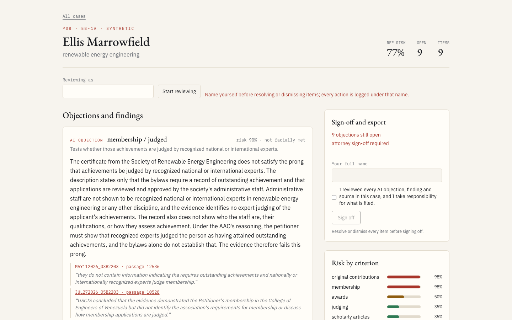
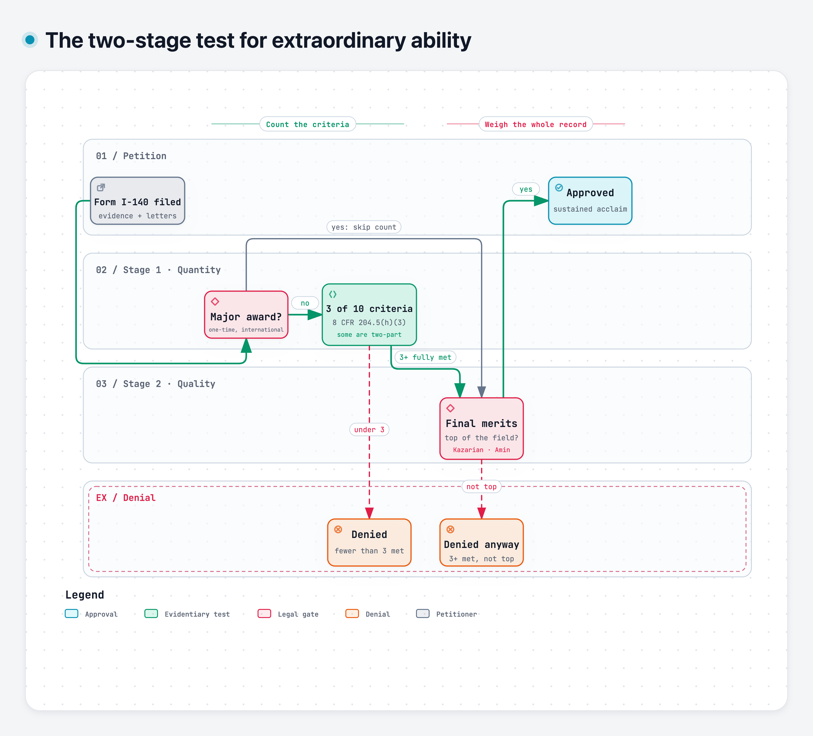
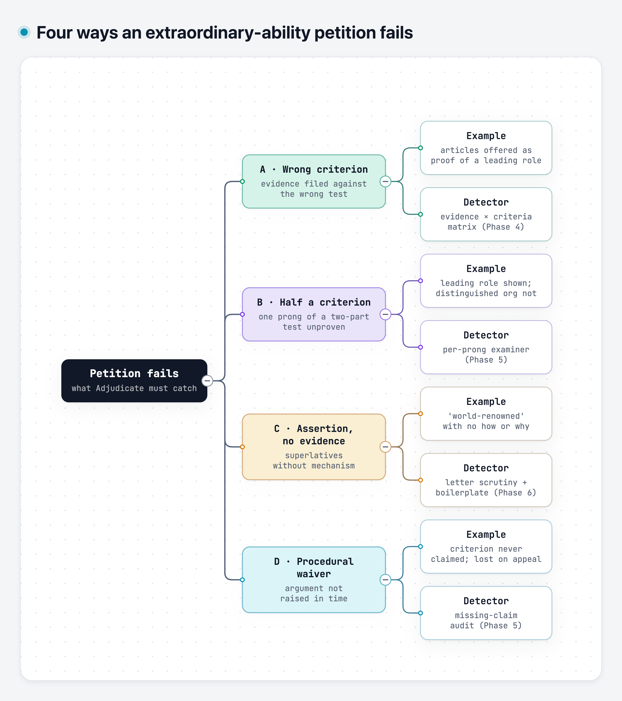
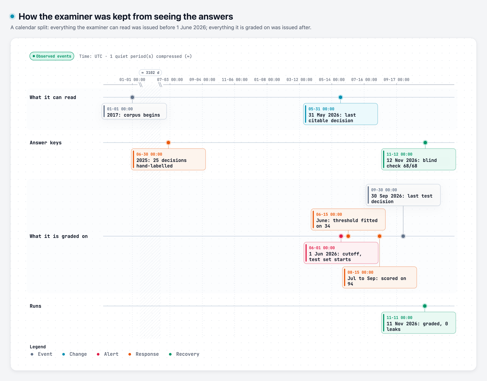
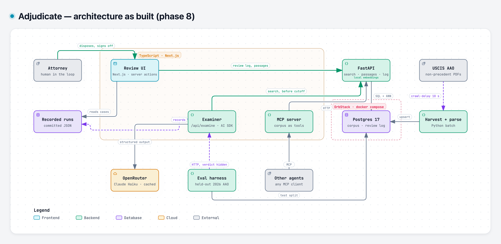

# Adjudicate

**An adversarial pre-filing reviewer for extraordinary-ability immigration petitions.**

Adjudicate reads an EB-1A petition the way a skeptical USCIS officer would, before it is filed. For every criterion the petition claims, it writes the strongest objection an officer could raise, and it backs each objection with real reasoning from the Administrative Appeals Office (AAO), quoted word for word. An attorney then goes through every objection, resolves or dismisses it with a note, and signs off. Nothing leaves the tool until that is done.

It is a portfolio prototype, built in nine phases with a measured exit gate at each one. Every petition and applicant in it is synthetic. It is not legal advice.

<p align="center">
  
</p>
<p align="center"><sub>The review page for a synthetic case. Each objection cites the AAO passages it relies on; click one and the full passage opens with the quoted words highlighted.</sub></p>

---

## Contents

- [Why this exists](#why-this-exists)
- [What it looks for](#what-it-looks-for)
- [How well it works](#how-well-it-works)
- [What the numbers do not tell you](#what-the-numbers-do-not-tell-you)
- [Architecture](#architecture)
- [Run it yourself](#run-it-yourself)
- [Find your way around the diagrams](#find-your-way-around-the-diagrams)
- [Repository layout](#repository-layout)
- [How it was built](#how-it-was-built)
- [What failed, and what I would change](#what-failed-and-what-i-would-change)

---

## Why this exists

An EB-1A petition ("alien of extraordinary ability") has to prove that the applicant meets at least three of ten criteria, such as judging the work of others, original contributions of major significance, or a leading role at a distinguished organization. USCIS then weighs the whole record in a second, holistic step. That two-step reading comes from *Kazarian v. USCIS*, and it is where many petitions fall apart.

When a petition fails and is appealed, the AAO publishes its decision. Thousands of these non-precedent decisions sit on the USCIS website, and together they are a detailed record of what officers actually object to: invitations to review that never show the review happened, "leading role" letters that never describe the role, praise without any mechanism behind it.

That record is public but hard to use. Adjudicate turns it into a reviewer you can run on a draft petition, one that argues against you on purpose and has to show its sources.

<p align="center">
  
</p>

---

## What it looks for

The examiner is built around four ways petitions commonly fail:

| | Failure mode | What it means | Example |
|---|---|---|---|
| **A** | Wrong criterion | Evidence is filed under a criterion it does not support. | A conference talk filed as a "scholarly article". |
| **B** | Half a criterion | A two-part criterion where only one half is proven. | Proof of a leading role, but nothing on the organization's distinguished reputation. |
| **C** | Assertion without mechanism | A letter calls the work groundbreaking but never says what it changed, for whom, or how anyone knows. | "Dr. X is one of the most brilliant engineers of her generation." |
| **D** | Waiver | Something that is not raised now cannot be raised on appeal (*Matter of O-R-E-*). | Evidence that supports a criterion the petition never claims. |

<p align="center">
  
</p>

---

## How well it works

Each phase had a gate that had to pass before the next one started. Most of the gates in phases 4 to 6 run on **synthetic** petitions with planted flaws, which tells you the machinery works but says little about the real world. Phase 7 is the real test.

### The real test: 145 AAO decisions the examiner had never seen

I took every EB-1A merits decision the AAO issued from June to September 2026. I stripped each one down to the facts (what was submitted, never what anyone concluded about it) and ran the examiner on the result. Retrieval was restricted to decisions issued before 1 June 2026, so the examiner could not read the answer. Then I compared its risk scores with what the AAO actually decided, criterion by criterion.

<p align="center">
  
</p>

**Results on the criteria the AAO itself decided:**

| | F1 | Recall | Precision | AUROC |
|---|---:|---:|---:|---:|
| **Adjudicate** (risk ≥ 0.5) | **0.80** (95% CI 0.75–0.84) | **0.99** | 0.67 | **0.66** |
| Always say "not met" | 0.78 | 1.00 | 0.65 | n/a |
| Copy the Director's finding | 0.83 | 0.78 | 0.90 | n/a |

**With a threshold fitted on June and scored only on July to September (94 decisions):**

| | F1 |
|---|---:|
| Adjudicate (threshold 0.82) | 0.79 |
| Always say "not met" | 0.79 |
| Copy the Director's finding | 0.84 |

**How to read this.** Adjudicate catches almost every criterion the AAO rejected; it misses 3 of 348. It is a strong objector. It is a weak discriminator, though: at a fitted threshold it does no better than a baseline that always says "not met". That baseline is hard to beat because most appealed criteria really do fail. Copying the Director's finding scores higher, but no pre-filing tool has that finding, so treat it as a ceiling rather than a competitor.

Where it goes wrong:

- **Judging is the weakest criterion.** F1 is 0.39 and precision 0.25: it objects to judging evidence the AAO accepted.
- **Missing descriptions draw objections.** 71 of the false positives fall on criteria where the decision never described the evidence, so the examiner saw a gap and objected.
- **Outcomes add nothing.** Predicting whether the appeal is dismissed comes out at 0.89, exactly the rate of always guessing "dismissed".

The test was checked for leaks:

- **Split guard.** 5,864 passages were retrieved or cited, and each was checked against the cutoff, with 0 violations. A single violation stops the run.
- **Leak lexicon.** The fact extraction is screened for verdict words. 4 of 145 decisions still leaked after three attempts and were dropped and counted, not quietly kept.
- **Regression gate.** The numbers are committed in [`eval/results/phase7_real.json`](eval/results/phase7_real.json), and `make verify` fails if a later change drops AUROC or F1 by more than 0.05.

### Every phase gate

| Phase | What was measured | Result |
|---|---|---|
| 1. Harvest | Decisions fetched politely (robots crawl-delay of 10 s) | 729 decisions (EB-1A 450, O-1 219, NIW 60), 0 duplicates, 0 failures |
| 2. Parse | Field accuracy against 25 hand-labelled 2025 decisions | **94.2%** (311 of 330 fields). Owner's blind re-label of 5: **68 of 68** fields agree |
| 3. Retrieval | Recall@10 on 44 labelled queries | **0.89** hybrid (vector 0.84, lexical 0.66) |
| 4. Mapper | Evidence assigned to the right criterion, 20 synthetic petitions | 100% top-1, every planted mode-A mismatch caught, 0 false flags |
| 5. Examiner | Grounding and planted flaws, held-out synthetic set | 150 objections, 344 citations, **0 fabricated**; mode B 24/24, mode D 16/16 |
| 6. Letters | Assertion-without-mechanism (mode C), held-out letters | precision 1.00, recall 1.00 (a keyword baseline gets 0.62 / 0.47) |
| 6. Merits | Kazarian step two on strong/weak pairs, held-out | every weak petition caught (6/6), every pair ordered (6/6), 5 of 6 strong petitions passed |
| 7. Real eval | 145 held-out AAO decisions | see above |
| 8. Review UI | Browser test of the attorney's flow | passes: all 17 citations open the exact quote, export blocked until sign-off |

The whole project ran on about **$4** of Claude Haiku calls through OpenRouter. Every call is cached on disk and capped by a budget, and embeddings run locally.

---

## What the numbers do not tell you

These caveats matter as much as the scores.

- **Survivorship bias.** AAO decisions exist only for petitions that were denied and then appealed. Most of them are dismissals, so "not met" is the right answer most of the time. That is why "always say not met" is such a strong baseline, and why the table above reports it.
- **The synthetic gates are easy.** The petitions in phases 4 to 6 were generated from labelled seeds, so the ground truth holds by construction. The same developer wrote the generator and the system, so perfect scores there show the machinery works, not that it generalizes. The planted letter boilerplate, for example, was far easier to spot than real paraphrase.
- **The labels are not an attorney's.** The parser's labels were checked against a hand-labelled gold set and a blind re-label by the repository owner, not by an immigration attorney.
- **The text is OCR.** The decisions are redacted PDFs with an imperfect text layer (`EB-I`, `ofthe`, `8 C.F .R.`). Normalization repairs the common defects, not all of them.
- **O-1 is thin.** O-1 decisions are harvested and classified, but the examiner and the eval cover EB-1A only.
- **It is a prototype.** It has no authentication, and the names in the review log are self-reported. It is not legal advice.

---

## Architecture

<p align="center">
  
</p>

Two languages, each doing what it is good at:

- **Python owns the data.** That covers harvesting and parsing the AAO PDFs, OCR repair, per-criterion verdict extraction, local embeddings (bge-small), hybrid search (pgvector plus Postgres full-text, fused with reciprocal rank fusion), the FastAPI service, and the evaluation harness.
- **TypeScript owns the agent and the UI.** The examiner runs in a Next.js route on the Vercel AI SDK. An MCP server exposes the corpus as tools to any agent, and the review UI is built on Server Actions.
- **One schema.** Pydantic models are the single source of truth. Zod schemas are generated from them, and `make verify` fails if the two drift apart.
- **The eval treats the examiner as a black box.** The Python harness calls the TypeScript examiner over HTTP, so there is exactly one examiner implementation and the eval cannot reach inside it.

A few rules hold everywhere:

- **No ungrounded claim is shown.** Every citation must point to a passage that was actually retrieved, and its quote must appear verbatim. A citation that fails gets one corrective retry and is then dropped. A prong that cannot be grounded is shown as "not reviewed" and never quietly passed.
- **The attorney has the last word.** Each objection is resolved or dismissed with a note, in an append-only log the database refuses to edit. The memo exports only after a sign-off that postdates the last change, and the server enforces that, not just the button.
- **Failures are loud.** A down database is a 503, never an empty result. For a tool that argues from precedent, "corpus unavailable" must never look like "no precedent found".

---

## Run it yourself

### What you need

- macOS or Linux with Docker (I use [OrbStack](https://orbstack.dev))
- [uv](https://docs.astral.sh/uv/) for Python, and Node 20 or newer
- `pdftotext` from poppler (`brew install poppler`)
- An [OpenRouter](https://openrouter.ai) key, needed only for the steps that call a model

### Set up

```bash
git clone https://github.com/Amith71965/adjudicate.git
cd adjudicate
cp .env.example .env        # add OPENROUTER_API_KEY; ADJUDICATE_LLM_BUDGET_USD caps spend
make setup                  # Python venv + Node packages
make up                     # Postgres 17 + pgvector in Docker, then migrations
make verify                 # lint, types and every test (no network, no model calls)
```

### Build the corpus

This is slow on purpose. The harvester honors the USCIS robots crawl-delay of 10 seconds.

```bash
make harvest     # about 2 hours, resumable, free
make parse       # about a minute, free
make extract     # per-criterion verdicts with Claude Haiku, under $1, capped
make index       # chunk and embed locally, about 20 minutes on a laptop CPU
```

### Use it

```bash
make api         # retrieval API on :8000
make web         # review UI and examiner on :3000, in a second terminal
```

Open <http://localhost:3000>, pick a case, and name yourself under "Reviewing as". Work through the objections, then sign off and export the memo.

### Re-run the evaluations

| Command | What it checks |
|---|---|
| `make eval-parse` | Parser accuracy on the gold set |
| `make eval-retrieval` | Retrieval recall@10 by mode |
| `make eval-mapper`, `make eval-examiner` | Synthetic gates for phases 4 and 5 |
| `make eval-letters`, `make eval-merits` | Synthetic gates for phase 6 |
| `make eval-real` | The 145-decision held-out test (needs `make api` and `make web`) |
| `make e2e` | The attorney's flow in a real browser, against a throwaway copy of the review log |

Every model call is cached, so re-running an evaluation you have already run costs nothing.

> **On an 8 GB machine:** do not run Postgres, the Next dev server and a video render at the same time. `make down` frees the database's memory.

---

## Find your way around the diagrams

The README shows the four you need first. The rest go deeper into one part each. They are in `docs/diagrams/` and `docs/blog/` as SVG and PNG, and each has an `.archify.json` source next to it.

| If you want to understand… | Open |
|---|---|
| The system as it was first planned | [System architecture, Phase 0](docs/diagrams/00-architecture-system.png) |
| The system as it was actually built | [Architecture as built, Phase 8](docs/diagrams/08-architecture-final.png) |
| How decisions are collected from USCIS | [Harvest dataflow](docs/diagrams/01-dataflow-harvest.png) |
| How a PDF becomes structured decisions and verdicts | [Parse workflow](docs/diagrams/02-workflow-parse.png) and [corpus pipeline](docs/blog/blog-03-corpus-pipeline.png) |
| How the database is laid out | [Corpus ERD](docs/diagrams/02-erd-corpus.png) |
| What happens when you search the corpus | [Retrieval sequence](docs/diagrams/03-sequence-retrieval.png) |
| How the examiner argues and checks its own citations | [Examiner sequence](docs/diagrams/05-sequence-examiner.png) |
| How recommendation letters and the final merits step are reviewed | [Letters and merits workflow](docs/diagrams/06-workflow-letters-merits.png) |
| How the real held-out evaluation runs, step by step | [Real-eval workflow](docs/diagrams/07-workflow-real-eval.png) |
| The legal test, in one picture | [Two-stage test](docs/blog/blog-01-two-stage-test.png) |
| The four failure modes | [Failure modes](docs/blog/blog-02-four-failure-modes.png) |
| Why the test set is truly unseen | [Temporal split](docs/blog/blog-04-temporal-split.png) |

---

## Repository layout

```
adjudicate/
├── py/                      Python: data, retrieval API, evaluation
│   ├── adjudicate/
│   │   ├── harvest/         polite crawler for USCIS AAO decisions
│   │   ├── parse/           PDF text, OCR repair, structure, LLM verdicts, gold-set scoring
│   │   ├── retrieve/        chunking, local embeddings, hybrid search
│   │   ├── api/             FastAPI: search, passages, decisions, review log
│   │   ├── eval/            held-out evaluation: facts-only extraction, split guard, metrics
│   │   ├── synth/           seeded synthetic petitions and letters with planted flaws
│   │   ├── schemas/         Pydantic models (the schema source of truth)
│   │   └── llm/             capped, cached LLM client
│   └── tests/               pytest, including the 25-decision gold set
├── web/                     TypeScript: examiner, MCP server, review UI
│   ├── lib/examiner/        mapper, adversarial examiner, citation validation, risk
│   ├── lib/letters/         assertion-without-mechanism, boilerplate, independence
│   ├── lib/review/          cases, review state, export gate
│   ├── mcp/                 MCP server exposing the corpus as tools
│   ├── app/                 Next.js pages, Server Actions, API routes
│   ├── tests/               vitest unit and component tests
│   └── e2e/                 Playwright: the attorney's flow
├── db/migrations/           plain SQL migrations, applied by a tested runner
├── eval/                    synthetic sets, labelled queries, committed results
├── docs/diagrams/           architecture and workflow diagrams
├── docs/blog/               explainer images
└── Makefile                 every entry point: `make help`
```

---

## How it was built

- **Phases with exit gates.** Nine phases, one branch and one pull request each. A phase was finished only when its measured gate passed.
- **Test first.** Every behavior began as a failing test, then the code to make it pass, then a commit. The suite has more than 500 Python tests and almost 200 TypeScript tests, plus the browser flow.
- **Reviewed at every boundary.** Independent review passes looked for silent failures, security issues and RAG mistakes at the end of each phase. Their findings were fixed test-first, or written down with a reason when left as they were.
- **Decisions on record.** Each major choice was recorded with its reasoning, including the ones I reversed. One example is moving from a paid legal embedding model to a free local one: I chose not to depend on a card-billed API, then measured the local model against the retrieval gate before committing to it.
- **Spending capped.** Every model call goes through a client with a hard dollar cap and a disk cache, so a replay is free and a bug cannot run up a bill.

---

## What failed, and what I would change

- **The examiner objects too readily.** At a threshold it ties a constant baseline. Its risk scores barely separate criteria the AAO accepted from ones it rejected (AUROC 0.66). Next I would calibrate per criterion, starting with judging, and stop treating a missing description as missing evidence.
- **Keeping verdicts out of the facts was harder than expected.** AAO decisions describe evidence in the language of the conclusion ("the petitioner submitted *only*…"). The first extraction leaked verdicts in 11% of decisions. It took a strict no-verdict schema, a leak lexicon and a third, narrower attempt to get to 3%.
- **Several full runs broke before one finished.** Threads shared a TLS connection, outputs were truncated by hidden reasoning tokens, a single over-long field crashed the run, and replays were not deterministic because truncations were not cached. Each fix is now a test.
- **The synthetic gates were too kind.** Perfect scores on data I generated told me less than one honest run on real decisions. I would have run a small real-data pilot much earlier.
- **Copying a whole database crashed Postgres.** The browser test now writes to its own throwaway schema instead, which is faster and safer. The real review log is append-only, so a test must never touch it.
- **What I would add:** real authentication, so the sign-off means something; O-1 and NIW reasoning in the examiner; variance across repeated runs; and a review by a practicing immigration attorney.

---

<sub>Synthetic petitions and applicants only; no real personal data is stored anywhere in this repository. AAO decisions are public, redacted government records, fetched from uscis.gov at the rate its robots.txt asks for; the only decision text committed is the 25-decision gold set and six parser fixtures (see <a href="py/tests/golden/README.md">the gold-set README</a>). Everything binds to localhost. This is an engineering prototype, not legal advice.</sub>
